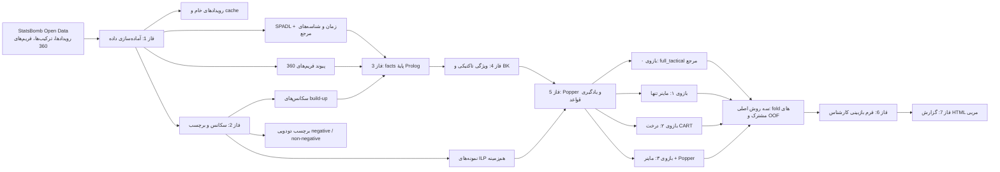
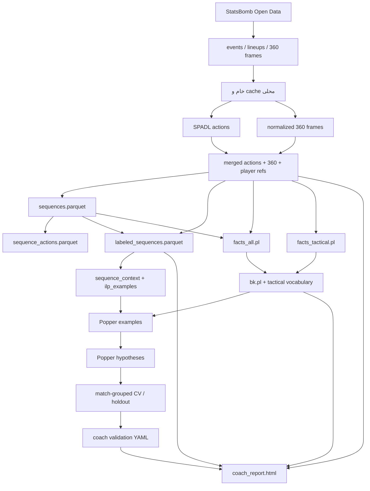

# گزارش پژوهشی و معماری پروژهٔ تحلیل تاکتیکی فوتبال

**کاربرد:** نقطهٔ شروع نگارش مقاله، گزارش روش، و تشریح بازتولیدپذیر خط لوله.

## چکیدهٔ اجرایی

این پروژه یک خط لولهٔ داده‌محور و نمادین برای کشف الگوهای تاکتیکی مرتبط با پیامد نامطلوب در سکانس‌های بازی‌سازی FC Barcelona و Bayer 04 Leverkusen طراحی می‌کند. فاز ۵ سه روش اصلی را با foldهای مسابقه‌ای مشترک مقایسه می‌کند: ماینر ترتیبی تنها، درخت تصمیم CART و روش هیبرید ماینر + Popper. مسیر Popper با واژگان تاکتیکی کامل (`full_tactical`) به‌عنوان بازوی ۰ و مرجع ثانویه حفظ می‌شود. قواعد با ارزیابی گروه‌بندی‌شده بر حسب مسابقه بررسی و برای پذیرش تاکتیکی به کارشناس ارائه می‌شوند. گزارش HTML مربی تنها قواعدی را که انسان بازبینی کرده است با وضعیت روشن نمایش می‌دهد.


## ۱. هدف، پرسش و دامنهٔ پژوهش

### ۱.۱ هدف

هدف محاسباتی پروژه شناسایی ترکیب‌هایی از الگو های تاکتیکی است که در دادهٔ رویدادی با احتمال بیشترِ «پیامد منفی build-up» همراه‌اند، و بیان این ترکیب‌ها به‌شکل قواعد منطقی قابل‌تفسیر. هدف کاربردی، فراهم‌کردن شواهد قابل‌ممیزی برای بررسی مربی/تحلیلگر است؛ نه صدور توصیهٔ خودکار یا تشخیص قطعی علت شکست. همچنین کمک برای کشف الگو های مخربی که رمبی به راحتی امکان کشف آنها رو شاید نداشته باشه بصورت دقیق(چون تعداد تکرارشون کمه و در ذهن نمیمونن در طول فصل و به چشم نمیاد اما همون یکبار اتفاق افتادنش میتونه سرنوشت تیم رو رد فصل عوض کنه!)

### ۱.۲ پرسش محوری پیشنهادی برای مقاله

> آیا یادگیری استقرایی منطق از ویژگی‌های تاکتیکیِ استخراج‌شده از رویدادها و فریم‌های ۳۶۰ می‌تواند قواعد کوتاه، قابل‌تفسیر و نسبتاً پایدار دربارهٔ سکانس‌های build-up ناموفق FC Barcelona استخراج کند، و آیا افزودن الگوهای تاکتیکی ترتیبی نسبت به واژگان تاکتیکیِ غیرترتیبی ارزش پیش‌بینی/تفسیر افزوده دارد؟

این پرسش را می‌توان به سه پرسش فرعی شکست:

1. چه قواعد منطقی روی دادهٔ آموزشی پیدا می‌شوند و پشتیبانی/دقت آن‌ها در مسابقه‌های کنارگذاشته‌شده چقدر است؟
2. در مقایسهٔ مشترک روی مسابقه‌های کنارگذاشته‌شده، ماینر تنها، CART و هیبرید ماینر + Popper چه تفاوت توصیفی در معیارهای OOF دارند؟
3. کدام قواعد و الگوها از نظر متخصص تاکتیکی معنادار، قابل‌توضیح و با شواهد و محدودیت‌های داده سازگارند؟

### ۱.۳ دامنهٔ داده (تست روی بایرون لورکوزن هم انجام شده اما در این متن مشخصات دیتاست اونو یادم رفت ثبت کنم)

- منبع: StatsBomb Open Data.
- رقابت/فصل: La Liga 2020/21؛ `competition_id=11`, `season_id=90`.
- تیم کانونی: FC Barcelona؛ `team_id=217`.
- جامعهٔ مسابقه: ۳۵ بازی بارسلونا که در اسناد پروژه با دادهٔ ۳۶۰ معرفی شده‌اند.
- دستگاه مختصات: SPADL با ابعاد ۱۰۵×۶۸ متر؛ Barcelona در تمام مسابقه‌ها به سمت `+x` حمله می‌کند، `x=0` دروازهٔ خودی، `x=105` دروازهٔ حریف، و `y=0` سمت راست از دید حملهٔ Barcelona است.

پوشش ۳۶۰ برای همهٔ اکشن‌ها/فریم‌ها تضمین‌شده یا یکنواخت نیست. اسناد پروژه از وجود دادهٔ ۳۶۰ در ۳۵ مسابقه خبر می‌دهند، اما پوشش فریم برای هر اکشن و شمار سکانس‌های قابل‌استفاده باید از manifest و خروجی اجرای جاری گزارش شود.

## ۲. نمای کلی معماری



### ۲.۱ لایه‌های معماری

1. **داده و cache:** دریافت دادهٔ خام و نگهداری نسخه‌های محلی برای بازتولید و کاهش درخواست شبکه.
2. **تبدیل و ویژگی‌سازی:** تبدیل رویدادها به SPADL، اتصال ۳۶۰، زمان‌بندی و محاسبهٔ هندسه.
3. **مدل دامنه:** تعریف build-up، پیامد عملیاتی، مفهوم‌های تاکتیکی و قواعد پس‌زمینهٔ Prolog.
4. **یادگیری و ارزیابی:** ساخت مثال، bias، جست‌وجوی Popper، cross-validation گروه‌بندی‌شده بر مبنای مسابقه.
5. **بازبینی و ارائه:** تصمیم انسانی دربارهٔ هر قاعده و تولید گزارش تعاملی/خودبسنده.

## ۳. جریان کار (Workflow)

### فاز ۰ — کنترل آمادگی محیط

پیش از پردازش داده، نسخهٔ Python و بسته‌های تحلیل، سازگاری `socceraction`/`pandera`، وجود `uv`، نسخهٔ SWI-Prolog، checkout مربوط به Popper و دسترسی شبکه بررسی می‌شوند. این مرحله داده را تغییر نمی‌دهد. بستهٔ پایتون پروژه Python 3.11 تا قبل از 3.13 را هدف می‌گیرد؛ اجرای Popper به محیط جداگانه با Python حداقل 3.14 و `janus_swi` نیاز دارد. نسخهٔ SWI-Prolog لازم برای پل Popper حداقل 9.1.12 است.

**ورودی:** محیط اجرا. **خروجی:** گزارش آمادگی و کد خروجی موفق/ناموفق. **معيار عبور:** وابستگی‌های لازم برای مسیر منتخب نصب و قابل‌اجرا باشند.

### فاز ۱ — دریافت و آماده‌سازی رویدادها

1. خواندن فهرست مسابقات فصل و گزینش بازی‌های Barcelona.
2. دریافت/cache رویدادها، ترکیب بازیکنان و freeze-frameهای ۳۶۰.
3. پاک‌سازی رویدادهای فاقد مختصات معتبر و تبدیل رویدادها به اکشن‌های SPADL.
4. هم‌راستا کردن جهت بازی در دستگاه مختصات مشترک.
5. تبدیل مختصات فریم خام StatsBomb به مقیاس SPADL و پیوند فریم به اکشن متناظر.
6. ساخت مرجع بازیکن/نقش و حفظ metadata موردنیاز، مانند ارتفاع پاس، در صورت دسترسی.

**محصولات محوری:** parquetهای خام و پردازش‌شده شامل matches/events/lineups/frames، `spadl_all_matches.parquet`، `spadl_with_360_all_matches.parquet` و `players_reference.parquet`؛ نام دقیق و وضعیت موجودی را باید از اجرای بستهٔ جاری تأیید کرد.

### فاز ۲ — ساخت واحد تحلیل، پیامد و مثال‌های ILP

**تقسیم‌بندی build-up:** اکشن‌ها به ترتیب زمان/شناسه مرتب و بر اساس دوره و مالکیت گروه‌بندی می‌شوند. سکانس از نخستین اکشن مجاز Barcelona در نیمهٔ خودی (`start_x ≤ 52.5m`) آغاز می‌شود و فقط اکشن‌های Barcelona را دربرمی‌گیرد. پایان‌های طبیعی عبارت‌اند از شوت، شکست اکشن، ورود کنترل‌شده به ناحیهٔ تهاجمی، و سپس پایان مالکیت؛ سقف طول ۲۵ اکشن است. فقط توالی‌های ۲ تا ۲۵ اکشنی نگه داشته می‌شوند. ورود به نواحی مشخص‌شده باید کنترل‌شده باشد؛ برای پاس، دریافت بعدی در همان ناحیه شاهد کنترل است. خروج موفق با شوت یا ورود کنترل‌شده به deep quarter، Zone 14 یا نیم‌فضای عمیق ثبت می‌شود.

**برچسب پیامد:** برچسب دودویی است. `negative` زمانی است که توپ در نیمهٔ خودی (`x ≤ 52.5m`) از دست برود، ظرف ۵ ثانیه بازپس‌گیری نشود و نخستین اکشن حریف foul نباشد؛ سایر موارد `non_negative` هستند. شوت حریف و ورود او به یک‌سوم دفاعی فقط متغیر توصیفی‌اند.

| ناحیهٔ باخت | شرط عملیاتی پیامد منفی |
|---|---|
| نیمهٔ خودی، `x ≤ 52.5m` | از دست‌رفتن توپ بدون بازپس‌گیری در ۵ ثانیه و بدون foul حریف |

شوت و ورود حریف به یک‌سوم دفاعی پیامدهای توصیفی‌اند و label را تغییر نمی‌دهند. `non_negative` فقط یعنی شرط عملیاتی منفی برقرار نشده.

**نمونه‌گیری کنترل:** برای جلوگیری از تمایز صرفاً بر اساس زمینه، کنترل‌ها بر مبنای `start_zone`, `pressure_bucket`, `length_bucket` ابتدا دقیق و سپس با نردبان تطبیق انتخاب می‌شوند. هدف حداکثر دو کنترل به‌ازای هر نمونهٔ منفی است، با seed ثابت `202021`. تطبیق سراسری حداکثر ۵٪ کنترل‌هاست و نسبت پایین‌تر از هدف پذیرفته می‌شود اگر کنترل هم‌زمینه کم باشد. این نمونه‌گیری به‌تنهایی جایگزین holdout/CV نیست.

**محصولات محوری:** `sequences.parquet`, `sequence_actions.parquet`, `labeled_sequences.parquet`, `sequence_context.parquet`, `ilp_examples.parquet`.

### فاز ۳ — facts پایهٔ منطقی

ویژگی‌های ساختاری/هندسی اکشن و سکانس به facts ثابت Prolog سریال می‌شوند؛ مانند نوع و نتیجهٔ اکشن، actor، ترتیب اکشن، عضویت در سکانس، موقعیت مکانی، lane، طول پاس، فشار، نقش و اطلاعات پایهٔ بازیکن. برچسب هدف در `facts_all.pl` صادر نمی‌شود تا جست‌وجوی منطقی نتواند پاسخ را از facts بخواند؛ مثال‌های هدف جداگانه در فایل‌های Popper قرار می‌گیرند.

**محصول محوری:** `data/prolog/facts_all.pl` به‌همراه manifest نسخه‌دار. Factها snapshotهای محاسبه‌شده‌اند، نه قواعد زندهٔ Prolog.

### فاز ۴ — ویژگی‌های تاکتیکی و قواعد پس‌زمینه

با استفاده از مختصات SPADL و freeze-frameها، مفاهیمی مانند فشار، حمایت، مثلث، قفس پرس، عبور از خط، افتادن حامل بین خطوط، حمل توپ کناری، سوییچ و cycling پاس ساخته می‌شوند. بخشی به‌صورت facts در Python محاسبه می‌شود و بخشی با قواعد دستی Prolog در background knowledge (`bk.pl`) تعریف می‌شود. یک مفهوم می‌تواند به‌علت نبود داده یا محدودیت شناسایی بازیکنان ساخته نشود؛ نبود fact، به‌ویژه برای ویژگی‌های وابسته به ۳۶۰، الزاماً شاهد منفیِ تاکتیکی نیست.

**محصولات محوری:** `facts_tactical.pl`, `facts_tactical_manifest.json`, BK منبع در `src/tactical_ilp/prolog/bk.pl` و نسخهٔ runtime در `data/prolog/bk.pl`.

### فاز ۵ — یادگیری قواعد و الگوهای ترتیبی

فاز ۵ یک بازوی مرجع و سه روش اصلیِ مقایسه دارد:

- **بازوی ۰، `full_tactical` (مرجع ثانویه):** Popper از واژگان تاکتیکی بازبینی‌شده و wrapperهای سطح سکانس استفاده می‌کند. ویژگی‌های action-level روی پیشوند قابل مشاهده تعریف می‌شوند (`in_prefix/2`)؛ wrapperها اکشن نهایی حامل label را نمی‌بینند. واژگان پایهٔ فعال ۳۴ predicate است (۲۷ اکشن، ۶ سکانسی، ۱ بازیکن-سکانس؛ `aerial_pass` از جست‌وجو حذف است). سقف جاری `max_vars=2`, `max_body=3`, `max_clauses=4` است.
- **بازوی ۱، ماینر تنها:** در هر fold، patternها فقط از مسابقه‌های train استخراج می‌شوند. پیش‌بینی منفی زمانی صادر می‌شود که دست‌کم یکی از patternهای منتخب همان fold با sequence منطبق باشد (OR ساده). این بازو Popper و predicateهای پایه را برای تصمیم نهایی به‌کار نمی‌برد.
- **بازوی ۲، درخت CART:** درخت حداکثر عمق ۳ با حداقل ۱۰ نمونه در برگ روی ۳۴ predicate بولی سطح سکانس fit می‌شود.
- **بازوی ۳، `hybrid_sequential`:** الگوهای مرتب ۲ یا ۳ رخدادی در هر fold فقط از مسابقه‌های train استخراج می‌شوند؛ سپس الگوهای منتخب به facts اتمی سطح سکانس افزوده می‌شوند و Popper آن‌ها را با تمام predicateهای واژگان پایه در clauseهای منطقی ترکیب می‌کند.

در mining، رخدادها از predicate تاکتیکی، نوع SPADL و ناحیهٔ مکانی ساخته می‌شوند. فاصلهٔ مجاز بین رخدادها محدود است؛ الگوهای بسته فقط روی sequenceهای منفی train استخراج می‌شوند؛ سپس نرخ هدف و کنترل با هموارسازی alpha=0.5 مقایسه می‌شود. حداقل حمایت هدف ۵ و growth حداقل ۱.۵ است؛ این فیلتر heuristic است و عملکرد را باید با CV گروه‌بندی‌شده سنجید. اکشن پایانی پیش از استخراج pattern حذف می‌شود. سپس Popper از bias نوع‌دار و فایل‌های مثال Prolog استفاده می‌کند تا برنامه‌هایی کوتاه برای `negative_outcome(Sequence)` بیاموزد. Popper در پیکربندی noisy/MDL اجرا می‌شود؛ بنابراین خطای مجاز و اندازهٔ برنامه در جست‌وجو موازنه می‌شوند.

**محصولات محوری:** `exs.pl`, `exs_holdout.pl`, `bias.pl`, `bk.pl`, logهای Popper و metadata الگوها در `data/reports/phase5_sequential_training.json`.

### فاز ۵ ارزیابی — ارزیابی بر پایهٔ مسابقه

ارزیابی cross-validation مسابقه‌گروهی است؛ همهٔ سکانس‌های یک مسابقه در یک split می‌مانند تا واحدهای وابستهٔ یک بازی میان train و test پخش نشوند. سه روش اصلی از seed و همان سه fold استفاده می‌کنند. در هر fold، انتخاب pattern و fit طبقه‌بند فقط روی matchهای train انجام می‌شود و سنجش روی همهٔ سکانس‌های برچسب‌خوردهٔ matchهای کنارگذاشته‌شده با prevalence طبیعی صورت می‌گیرد. Arm 1 از همان مجموعهٔ compressed patternهای train-fold که به Arm 3 داده شده با OR ساده پیش‌بینی می‌کند؛ این یک ablation مستقیم برای سنجش ارزش افزودهٔ جست‌وجوی Popper است. معیارهای اصلی از OOF pooled محاسبه می‌شوند؛ قوانین منفرد/نامزدهای میانی که پس از جست‌وجو انتخاب شده‌اند، به‌علت سوگیری انتخاب معیار مستقل کیفیت نیستند. مقایسه فقط وقتی آماده است که گزارش‌ها نسخهٔ پروتکل و splitهای یکسان داشته باشند. اجرای ثابت سه‌fold توصیفی است و به‌تنهایی آزمون معناداری یا تعمیم به فصل/تیم مستقل ارائه نمی‌دهد.

یک holdout ثابت نیز در runnerهای آموزشی وجود دارد، اما بعد از مشاهدهٔ مکرر دیگر آزمون نهایی مستقل به‌شمار نمی‌آید. اگر خروجی آن برای تنظیم یا انتخاب قاعده استفاده شده، مقاله باید این را افشا کند و به CV گروه‌بندی‌شده یا ارزیابی جدید روی مسابقات دیده‌نشده تکیه کند.

### فاز ۶ — ارزیابی هر قاعده و بازبینی انسانی

برای هر قاعده معیارهای train/holdout از جمله support و confidence و افت عملکرد ثبت می‌شود؛ معیارهای مرتبط با lift/نرخ پایه و sanity check نیز در گزارش روش وجود دارند. خروجی YAML وضعیت هر قاعده را به `approved`, `rejected` یا `pending` نگه می‌دارد و برای تصمیم نهایی یادداشت انسانی لازم است. بازوی پیش‌فرض `hybrid_sequential` است؛ CV آن وضعیت انسانی را خودکار تغییر نمی‌دهد. فایل بازبینی به روش و fingerprint همان ورودی‌ها وابسته است تا تصمیم یک مدل به مدل دیگر نسبت داده نشود.

### فاز ۷ — گزارش مربی

فاز ۷ Popper را دوباره اجرا نمی‌کند؛ facts، labelها، metadata الگوها و YAML مربی را می‌خواند و HTML راست‌به‌چپِ خودبسنده می‌سازد. قواعد approved به‌عنوان یافته همراه با نرخ‌ها، lift، نمودار زمین و نمونه‌های سکانس نمایش داده می‌شوند؛ rejected و pending جداگانه و با وضعیت روشن ارائه می‌شوند. عبارت‌سازی patternها از metadata واقعی آموزش ساخته می‌شود؛ predicate ناشناخته حدس زده نمی‌شود. fingerprint اجازه می‌دهد تشخیص داده شود گزارش با ورودی‌های جدید stale شده است.

## ۴. جریان داده (Dataflow)



### ۴.۱ قراردادهای تبادل و جداسازی نقش داده

| لایه | شکل/فایل شاخص | نقش |
|---|---|---|
| منبع خام | parquet رویداد، ترکیب و فریم | واقعیت منبع و cache قابل‌بازتولید |
| اکشن استاندارد | SPADL parquet | واحد رویدادی با مختصات/زمان هم‌راستا |
| سکانس | sequences و membership parquet | واحد تحلیل و اتصال action-to-sequence |
| برچسب | labeled sequences parquet | outcome عملیاتی و ستون‌های ممیزی |
| مثال یادگیری | `ilp_examples.parquet` → `exs.pl` | کلاس هدف و split آموزشی |
| شواهد نمادین | `facts_all.pl`, `facts_tactical.pl` | زمینهٔ ground و بدون برچسب هدف |
| فرضیه | BK، bias و خروجی Popper | فضای تعریف و برنامهٔ یادگرفته‌شده |
| ارزیابی انسانی | YAML | ثبت پذیرش/رد/تعلیق و دلیل |
| محصول گزارش | HTML | ارائهٔ قابل‌مرور برای تحلیلگر/مربی |

جداسازی label از facts و استفاده از manifest/fingerprint دو کنترل مهم برای جلوگیری از آلودگی هدف و استفادهٔ ناخواسته از خروجی‌های کهنه‌اند. برای مقاله باید دقیقاً نسخهٔ data، vocabulary، bias، split، seed، تنظیم Popper و hash/شناسهٔ گزارش هر run ثبت شود.

## ۵. صورت‌بندی مسئله و نمایش منطقی

### ۵.۱ واحد مشاهده و هدف

واحد مشاهده یک سکانس build-up است. predicate هدف به‌شکل `negative_outcome(S)` تعریف می‌شود. نمونه‌های `pos(negative_outcome(S))` نمایندهٔ سکانس‌های دارای label=`negative` هستند و `neg(...)` نمایندهٔ `non_negative`. تمام sequenceها طبق تعریف فعلی در یکی از دو کلاس هستند.

### ۵.۲ زمینه و bias

به Popper مختصات خام پیوسته به‌عنوان فضای جست‌وجوی آزاد داده نمی‌شود؛ به‌جای آن مفاهیم Boolean/کم‌دامنه در bias نوع‌دار عرضه می‌شوند. ویژگی‌های اکشنی با wrapperهای وجودی به سطح سکانس منتقل می‌شوند، برای نمونه:

```prolog
seq_triangulation(S) :- in_prefix(A,S), triangulation(A).
```

پس این predicate وجود یک اکشن دارای ویژگی را بیان می‌کند؛ فراوانی، ترتیب یا هم‌زمانی چند ویژگی روی همان اکشن را خودبه‌خود بیان نمی‌کند. ترکیب چند predicate سکانسی نیز الزاماً به یک اکشن یا بازیکن مشترک اشاره ندارد.

### ۵.۳ الگوهای ترتیبی

در بازوی ترتیبی، اتم رخداد می‌تواند ترکیبی از مفهوم تاکتیکی، نوع SPADL، کانال شروعِ درشت‌دانه (چپ/مرکز/راست) و یک‌سوم طولی باشد. در این واژگان، بال و نیم‌فضای هم‌سمت ادغام می‌شوند؛ دسته‌بندی پایهٔ هندسی پنج‌lane باقی می‌ماند. mining محدود و محلی پروژه با I-extension و S-extension کار می‌کند، فاصلهٔ رخدادها را محدود می‌سازد و closure را با برابری دقیق مجموعهٔ sequenceهای پشتیبان می‌سنجد. این پیاده‌سازی در اسناد به‌عنوان miner محدودشدهٔ مبتنی بر prefix projection معرفی می‌شود؛ نباید بدون آزمون تطابق، آن را الگوریتم canonical مانند Gap-BIDE نامید.

مقادیر تنظیمی جاری در کد/اسناد شامل `max_gap=2`, حداقل حمایت عمومی ۵، حداقل حمایت هدف ۵، growth هموارشده با alpha=0.5 و آستانهٔ 1.5، طول pattern برابر ۲ تا ۳ رخداد، سقف ۸ pattern منتخب و سقف ۵۰٬۰۰۰ candidate است. این معیار رشد heuristic است و p-value یا ادعای معناداری محسوب نمی‌شود؛ الگوهای برگزیده باید فقط با نتایج CV مسابقه‌محور ارزیابی شوند. این تنظیمات باید از metadata همان run استخراج و در مقاله گزارش شوند؛ تغییر نسخه ممکن است آن‌ها را عوض کند.

## ۶. طراحی ارزیابی پیشنهادی برای مقاله

### ۶.۱ پروتکل پایه

1. یک تعریف ثابت و نسخه‌دار از build-up، label، vocabulary و sampling اعلام کنید.
2. داده را بر اساس مسابقه به foldهای گروهی تقسیم کنید؛ از split تصادفی در سطح سکانس اجتناب کنید.
3. همهٔ مراحلِ انتخاب ویژگی/الگو و یادگیری Popper را داخل train هر fold fit کنید.
4. همان سه fold مسابقه‌ای را برای ماینر تنها، درخت و هیبرید استفاده کنید؛ بازوی `full_tactical` را فقط مرجع ثانویه نگه دارید.
5. معیارهای اصلی را از پیش تعیین و بر OOF پیش‌بینی‌های همهٔ sequenceهای test با شیوع طبیعی محاسبه کنید.
6. گزارش کنید چند fold قاعدهٔ مشابه یا هم‌ارز کشف کردند؛ قواعد foldمحور را خروجی اکتشافی بدانید.
7. از holdout ثابت برای تنظیم مکرر استفاده نکنید؛ در صورت استفادهٔ قبلی، آن را شفاف افشا کنید.
8. تصمیم متخصصان را با روش بازبینی روشن ثبت کنید؛ برای توافق چند ارزیاب، کدگذاری مستقل و سنجهٔ توافق بین ارزیابان را در مطالعهٔ مقاله اضافه کنید.

### ۶.۲ معیارهای گزارش

برای طبقه‌بندی نامتوازن و قواعد sparse، حداقل این موارد را گزارش کنید:

- شمار مسابقه‌ها، سکانس‌ها و نمونه‌های هر کلاس در هر split؛ نرخ پایه و تعداد هر یک از دو label؛
- ماتریس اغتشاش، support، precision، recall، specificity، F1، lift، balanced accuracy و MCC روی OOF؛
- PR-AUC (و در صورت نیاز ROC-AUC) از پیش‌بینی‌های OOF؛
- support، confidence، coverage، lift و نرخ پایه برای هر قاعده؛
- پایداری قاعده در foldها و اندازه/پیچیدگی برنامهٔ منطقی؛
- فاصلهٔ اطمینان با bootstrap گروه‌بندی‌شده بر حسب مسابقه، نه بازنمونه‌گیری مستقل سکانس‌ها؛ این در نسخهٔ فعلیِ جدول مقایسه محاسبه نمی‌شود و برای استنباط مقاله‌ای باید جداگانه افزوده شود.
- مقایسهٔ جفت‌شدهٔ سه روش اصلی روی همان foldها و تحلیل حساسیت نسبت به seed/تعریف پیامد/نمونه‌گیری.

این‌ها توصیه‌های تکمیلی برای مقاله‌اند؛ وجود هر معیار در گزارش‌های فعلی را پیش‌فرض نگیرید. از artefactهای run جاری مشخص کنید چه چیزی محاسبه شده و چه چیزی باید افزوده شود.

### ۶.۳ آزمون‌های حساسیت و ablation مفید

- بدون فریم ۳۶۰ در برابر زیرمجموعهٔ دارای پوشش قابل‌قبول؛
- فقط full tactical در برابر hybrid sequential؛
- الگوهای بدون حذف suffix در برابر پروتکل حذف اکشن پایانی، صرفاً به‌عنوان تشخیص leakage؛
- تعریف پیامد با پنجره/آستانه‌های جایگزین که پیشاپیش تعیین شده‌اند؛
- نمونه‌گیری هم‌زمینه در برابر نمونه‌گیری کلّی با کنترل مناسب عدم‌توازن؛
- پایداری نسبت به seed نمونه‌گیری و حداقل support و آستانه FDR؛
- ترجمه/تفسیر expert-blinded، اگر ارزیاب از برچسب و معیارها بی‌خبر باشد.

## ۷. نکات کلیدی، تصمیم‌های مهندسی و کنترل‌های روش‌شناختی

1. **چارچوب مختصات واحد:** تیم‌ها به یک جهت حمله نگاشت می‌شوند تا lane، پیشروی و خطوط قابل‌مقایسه باشند. مسیر فریم ۳۶۰ باید همان تبدیل نهایی مختصات SPADL را دنبال کند.
2. **ورود کنترل‌شده:** مقصد پاس به‌تنهایی کنترل توپ را ثابت نمی‌کند؛ دریافت بعدی در همان ناحیه لازم است.
3. **تعریف پیامد دودویی:** منفی‌بودن به loss در نیمهٔ خودی و نبود regain پنج‌ثانیه‌ای وابسته است؛ opponent shot/entry فقط توصیفی گزارش می‌شوند.
4. **تعریف پیامد:** برچسب با محل loss و پنجرهٔ پنج‌ثانیه‌ای regain تعیین می‌شود؛ پیامدهای حریف به‌صورت توصیفی گزارش می‌شوند.
5. **نمونه‌گیری هم‌زمینه:** zone، فشار و طول برای کاهش shortcutهای زمینه‌ای استفاده می‌شوند، ولی این کار آزمون تعمیم را جایگزین نمی‌کند.
6. **حفاظت از leakage:** label در facts نیست؛ predicateهای متصل به label یا پیامد نزدیک از bias حذف می‌شوند؛ suffix در pattern mining mask می‌شود؛ استخراج pattern در هر fold فقط روی train است.
7. **ارزیابی گروهی:** واحد گروه‌بندی match است تا سکانس‌های یک مسابقه میان train و test نشت نکنند.
8. **سه روش اصلی با split مشترک:** مقایسهٔ ماینر، درخت و هیبرید فقط با foldهای یکسان و پروتکل همسان گزارش می‌شود؛ full_tactical مرجع ثانویه است.
9. **حلقهٔ انسانی:** قاعده تا پیش از بررسی کارشناس، یافتهٔ مربی محسوب 
نمی‌شود. 
"The qualitative screening was conducted by an independent coaching practitioner holding an official Asian Football Confederation (AFC) credential"
10. **نسخه‌گذاری:** manifest و fingerprint برای facts، روش، بازبینی و گزارش، منشأ خروجی را قابل‌ممیزی می‌کنند.

## ۸. محدودیت‌ها و تهدیدهای اعتبار

### ۸.۱ محدودیت منبع داده


- رخدادهای StatsBomb نمایش گسسته و ثبت‌شده از بازی‌اند، نه مسیر پیوستهٔ توپ یا همهٔ تصمیم‌های تاکتیکی.
- فریم ۳۶۰ ناقص/ناهمگون است و برای بازیکنان غیرحامل توپ player_id قابل‌دسترسی نیست؛ بنابراین موقعیت تیمی قابل‌تقریب است، اما ردیابی هویت فردی محدود می‌ماند.
- نقش‌های خط دفاع/میانه از موقعیت مکانی تقریبی استنباط می‌شوند؛ شناسایی واقعی مدافعان/هافبک‌ها در هر frame ممکن نیست.

### ۸.۲ محدودیت تعریف و اندازه‌گیری

- label، تعریف عملیاتی انتخاب‌شده است؛ `non_negative` معادل «موفقیت تاکتیکی» نیست.
- نقطهٔ turnover و transition از محل/زمان رخداد ثبت‌شده تخمین می‌شود.
- فشار، حمایت خطی، مثلث، پاس به دروازه‌بان، tempo و الگوهای پاس proxy هستند و همهٔ کیفیت‌های واقعی بازی را نمی‌سنجند.
- نبود fact برای ویژگی وابسته به فریم ممکن است ناشی از نبود مشاهده باشد، نه نبود پدیده.
- wrapperهای وجودی اطلاعات فراوانی و هم‌اکشنی را حذف می‌کنند.

### ۸.۳ محدودیت یادگیری و استنباط

- Popper فرضیه را برای مجموعهٔ نمونه و bias داده‌شده جست‌وجو می‌کند؛ فضای جست‌وجو کامل نیست.
- جست‌وجوی noisy/MDL، انتخاب متأثر از bias و سقف‌های تنظیمی است.
- انتخاب بهترین قانون از میان چندین نامزد، روی همان CV می‌تواند خوش‌بینی انتخاب ایجاد کند؛ nested CV یا مجموعهٔ بیرونی جدید برای ادعای مقایسهٔ انتخابی مناسب‌تر است.
- تکرار مشاهدهٔ holdout ثابت استقلال آن را از بین می‌برد.
- association rule دلیل علی برای پیامد نیست؛ confounding و عوامل بازی/حریف/بازیکن ممکن است دخیل باشند.
- بازبینی انسانی نیازمند گزارش تعداد ارزیاب، تخصص، کورسازی و شیوهٔ حل اختلاف است؛ اسناد فعلی یک فرم تصمیم انسانی را توصیف می‌کنند، نه مطالعهٔ توافق بین ارزیابان.


## ۱۱. واژه‌نامهٔ کوتاه

| اصطلاح | معنای مورد استفاده در پروژه |
|---|---|
| Action | رخداد استانداردشدهٔ SPADL با شروع/پایان، نوع، زمان و نتیجه |
| Build-up sequence | زنجیرهٔ ۲ تا ۲۵ اکشنیِ Barcelona که در شرایط فاز ۲ آغاز شده است |
| Negative outcome | تحقق یکی از شرایط عملیاتی باخت/تهدید انتقالی طبق ناحیهٔ زمین |
| Non-negative | معیار عملیاتی منفی برقرار نشده؛ نه الزاماً موفقیت |
| Inconclusive | شواهد کافی/قابل‌اعتماد برای برچسب دوگانه موجود نیست |
| ILP | یادگیری برنامهٔ منطقی از مثال‌ها، BK و bias |
| Popper | پیاده‌سازی ILP مورد استفاده برای جست‌وجوی فرضیه‌های Prolog |
| BK | قواعد و دانش پس‌زمینه‌ای که فضای تفسیر predicateها را تعریف می‌کند |
| Match-grouped CV | تقسیم fold بر حسب مسابقه، نه سکانس مستقل |
| OOF | پیش‌بینی هر نمونه از foldای که آن نمونه در آموزش آن نبوده است |
| Lift | نسبت نرخ پیامد در سکانس‌های منطبق با قاعده به نرخ پایه |
| Proxy | سنجهٔ قابل‌محاسبه‌ای که بخشی از مفهوم تاکتیکی را تقریب می‌زند |

## ۱۲. چک‌لیست پیش از استفاده در مقاله

- [ ] تعریف دودویی و متغیرهای توصیفی opponent shot/entry گزارش شده‌اند.
- [ ] splitها در سطح مسابقه‌اند و extraction الگو داخل fold انجام شده است.
- [ ] سه روش اصلی با foldهای یکسان و OOF مقایسه شده‌اند؛ full_tactical به‌عنوان مرجع ثانویه برچسب خورده است.
- [ ] معیارها، seedها، آستانه‌ها و نسخه‌ها ثبت شده‌اند.
- [ ] هر قانون همراه support، confidence، lift/نرخ پایه و پایداری fold آمده است.
- [ ] استفادهٔ مکرر از holdout افشا شده یا از آن برای نتیجهٔ اصلی صرف‌نظر شده است.
- [ ] محدودیت پوشش/هویت ۳۶۰ و تعریف عملیاتی outcome بیان شده است.
- [ ] قواعد به‌صورت association/فرضیه توصیف شده‌اند، نه علت قطعی.
- [ ] روش بازبینی کارشناسی و وضعیت هر قانون مستند است.
- [ ] مجوز و شیوهٔ ارجاع به StatsBomb Open Data مطابق شرایط منبع رعایت شده است.


