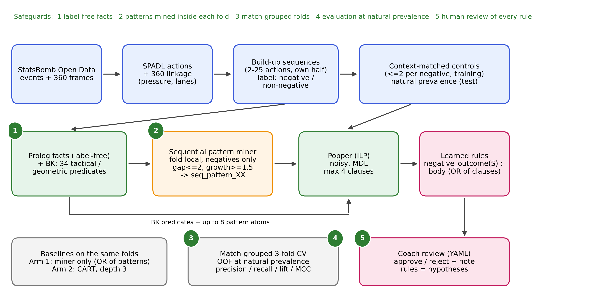
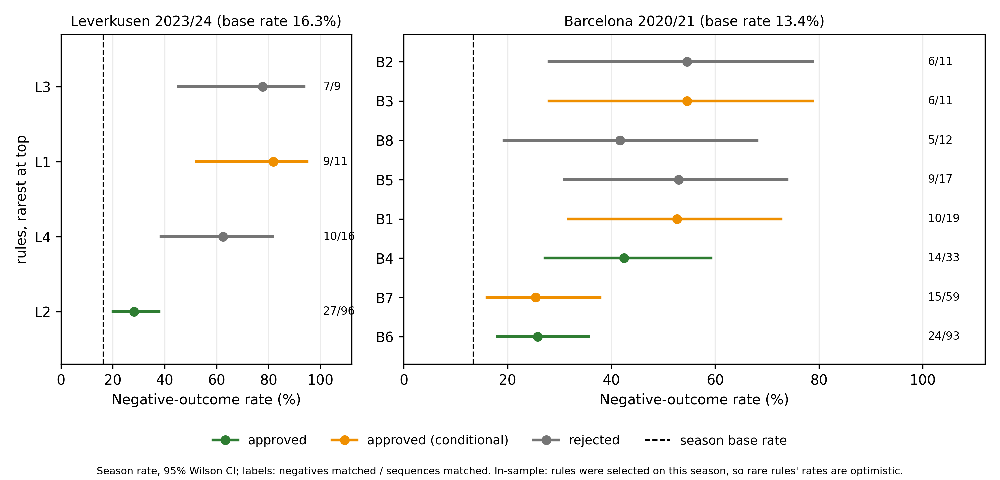

#  Hybrid Sequential Pattern Mining & Inductive Logic Programming for Tactical Build-up Analysis in Football

---

📄 **[Download Paper: Interpretable Rules for Rare Build-Up Failures in Football (Soccer): Sequential Pattern Mining Meets Inductive Logic Programming](./Interpretable%20Rules%20for%20Rare%20Build-Up%20Failures%20in%20Football.pdf)**

---

## 📌 Overview

Rare but costly build-up failures in football are difficult to detect during routine video review because each configuration may occur only a few times across an entire season.

This repository implements a **hybrid framework with leakage-controlled out-of-fold evaluation** that:
1. Converts **StatsBomb Event** and **StatsBomb 360** positional data into first-order Prolog facts.
2. Mines gap-constrained ordered patterns within each cross-validation training fold.
3. Uses **Popper** (Inductive Logic Programming) with Minimum Description Length (MDL) regularization to learn short, human-auditable relational rules for sequences ending in an unrecovered loss of possession in a team's own half.

> **Note:** The system is explicitly designed as a **hypothesis generator for tactical video review**, not a predictive model.

---

## 🏗 System Architecture & Pipeline

The framework incorporates five methodological safeguards to prevent data leakage and ensure rule validity, followed by expert human review.

  
   
  <em>Figure 1: Overview of the hybrid SPM + ILP pipeline architecture and processing stages.</em>

---

## 📊 Key Results & Empirical Findings

Evaluated on two distinct datasets: **FC Barcelona (2020/21)** and **Bayer Leverkusen (2023/24)**.

  
   
  <em>Figure 2: Performance metrics, lift comparisons, and rule acceptance rates.</em>

| Dataset | Base Rate | Hybrid Precision | Lift (95% match-cluster bootstrap CI) | Exploratory holdout AUC | Key Takeaways |
| :--- | :---: | :---: | :---: | :---: | :--- |
| **FC Barcelona (2020/21)** | 13.4% | **25.3%** | **1.89** [1.48–2.33] | **0.566** | CI above 1 (conditional on the saved fold models); comparable to baselines. |
| **Bayer Leverkusen (2023/24)** | 16.3% | **20.5%** | **1.26** [0.63–1.90] | **0.556** | CI includes 1, so inconclusive; no single stable winning method. |

> **How to read these numbers.**
> - Lift intervals are 95% percentile **match-cluster bootstrap** intervals (20,000 replicates; matches resampled with replacement within their test fold, all sequences of a match kept together; lift recomputed in every replicate). They are conditional on the saved fold-specific models and the split, and do not include model-refitting uncertainty. Wilson intervals for in-sample rule rates (Table IV of the paper) are sequence-level and not match-cluster adjusted.
> - Paired hybrid-minus-comparator lift differences include zero in all cases except Leverkusen hybrid vs. pattern-free Popper (−0.47, 95% CI −0.93 to −0.003), which is borderline, unadjusted for multiple comparisons, and not a general method ranking.
> - The review holdout (fixed 75/25 match split) also informed candidate ranking, so the holdout AUCs and per-rule holdout scores are **exploratory, selection-influenced estimates**, not independent held-out evidence. The out-of-fold comparison between methods does not use this holdout for selection.
> - Methods are compared as **complete procedures**, each with its own training population (the miner trains at natural prevalence; Popper and CART train on matched controls). The comparison does not isolate the individual contribution of the miner or of Popper. In Barcelona, pattern-free Popper found no program in fold 2 (zero positive predictions) but did in folds 1 and 3; the hybrid found a program in every fold.

* **Recall:** Deliberately low (**5–17%**) to prioritize high precision and actionable tactical insights over broad coverage.
* **Domain Expert Evaluation:** An **AFC-certified football coach** evaluated the learned logic rules, approving **7 out of 12** reviewed rules (4 of which were approved conditionally).
* **Limitations:** The absence of full, continuous tracking data bounds overall predictive accuracy, reinforcing its core utility as a targeted hypothesis generator. Each study covers one team in one season, so no generalization claim is made.

---

## 🔁 Reproducibility

StatsBomb Open Data is publicly available, but this alone does not identify the exact analysis subset or split used here. This repository therefore provides:

- the code (`src/tactical_ilp`, `scripts/`) and the dependency lock file (`pyproject.toml`, `uv.lock`);
- full run logs and coach-review artifacts in `_Results & Reports_/`, including the random seeds and the match lists of each split;
- `match_split_manifest.csv`, listing the matches used for each team-season with their cross-validation fold (`cv_fold`) and coach-review split assignment (`train` / `review_holdout`);
- `oof_match_confusion_counts.csv`, the per-match out-of-fold confusion counts (TP, FP, FN, TN) for every method, from which Table III and the bootstrap intervals are computed;
- `match_cluster_bootstrap_oof.md`, the match-cluster bootstrap report (intervals, paired differences, seeds, and the script that produced them).

---

## 📝 Abstract

> **Abstract** — Rare but costly build-up failures are difficult to detect in routine video review because each configuration may occur only a few times in a season. We present a leakage-controlled hybrid method that converts StatsBomb event and 360 data into Prolog facts, mines gap-constrained ordered patterns within each training fold, and uses Popper inductive logic programming with minimum description length (MDL) to learn short, auditable rules for sequences ending in an unrecovered loss of possession in a team’s own half. Five methodological safeguards and human review of every rule are integral to the design. On Barcelona 2020/21 and Bayer Leverkusen 2023/24, the hybrid reaches 25.3% precision against a 13.4% base rate for Barcelona (lift 1.89; 95% match-cluster bootstrap CI 1.48–2.33) and is comparable to the baselines. For Leverkusen, lift is 1.26 (95% match-cluster bootstrap CI 0.63–1.90), and no method is a stable winner. Recall is deliberately low (5–17%). An AFC-certified coach approved 7 of 12 reviewed rules, including four conditionally. The system is a hypothesis generator for video review, not a predictor; absence of full tracking limits accuracy.

---

## 🏷 Keywords

`football build-up` • `inductive logic programming` • `sequential pattern mining` • `interpretability` • `StatsBomb 360` • `sports analytics`
